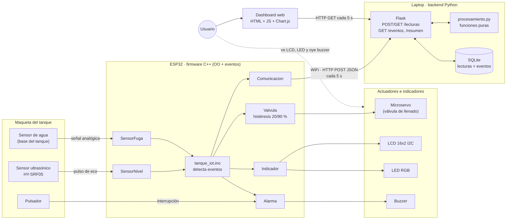

# Arquitectura de la solución (Requerimiento 1)

El ESP32 lee los sensores, decide y actúa **localmente** (aunque no haya red) y envía
cada lectura por WiFi al servidor Flask, que la guarda en SQLite y la sirve al dashboard.

## Componentes

| Capa | Componente | Función |
|------|-----------|---------|
| Dispositivo IoT | ESP32 DevKit | Lee sensores, controla actuadores, envía datos por WiFi |
| Sensores | HY-SRF05 (compatible con HC-SR04) | Distancia al agua → nivel en % (RF-01) |
| | Sensor de agua | Fuga o desborde en la base (RF-05) |
| | Pulsador | Silenciar la alarma (RF-07) |
| Actuadores | Microservo | Válvula de llenado simulada (RF-06) |
| | LCD 16x2 I2C, LED RGB, buzzer | Aviso local del estado (RF-02, RF-03, RF-04) |
| Procesamiento | Firmware C++ | Control local, histéresis, eventos |
| | `procesamiento.py` | Estadísticas y detección de eventos con funciones puras |
| Servicio | Flask | API REST y servidor del dashboard |
| Base de datos | SQLite | Histórico de lecturas y eventos (RF-09) |
| Comunicación | WiFi + HTTP/JSON | ESP32 → servidor cada 5 s (RF-08); dashboard → servidor cada 5 s (RNF-06) |
| Usuario | Persona a cargo del tanque | Consulta el dashboard y atiende las alarmas locales |

## Flujo de un dato

1. `SensorNivel` mide la distancia (mediana de 3 ecos) y la convierte en porcentaje.
2. `tanque_iot.ino` compara con el estado anterior: si cambió, dispara el evento (por ejemplo, `nivel_critico`).
3. `Valvula` decide si abre o cierra; `Indicador` y `Alarma` actualizan LCD, LED y buzzer. Esto pasa **sin depender de la red** (RNF-02).
4. Cada 5 s, `Comunicacion` envía un JSON por HTTP POST a `/lecturas`.
5. Flask valida la lectura, la compara con la anterior (`detectar_eventos`), guarda lectura y eventos en SQLite.
6. El dashboard pide `/lecturas`, `/eventos` y `/resumen` cada 5 s y redibuja sin recargar.

> GitHub dibuja el diagrama Mermaid de arriba. Para la presentación se puede exportar a
> PNG desde [mermaid.live](https://mermaid.live) y guardarlo en `docs/diagramas/`.
