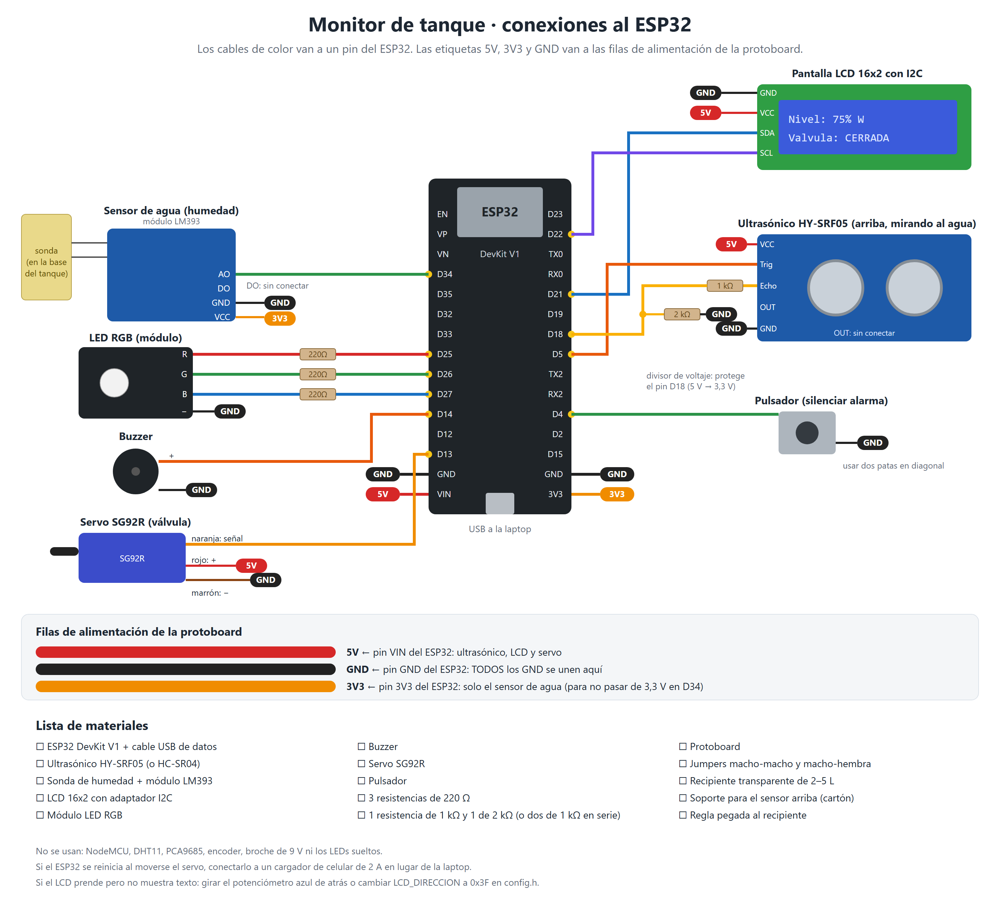
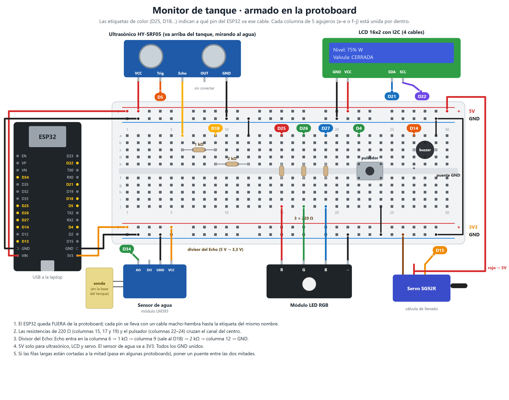

# Firmware (ESP32 · C++ · Arduino IDE)

Paradigmas: **orientado a objetos** (una clase por componente físico) y
**orientado a eventos** (el programa reacciona a cambios: nivel, fuga, botón, WiFi).

## Archivos en `tanque_iot/`

| Archivo | Contenido | Requisito |
|---------|-----------|-----------|
| `tanque_iot.ino` | `setup()` y `loop()`: crea los objetos, detecta eventos y llama a sus manejadores `alEvento...()` | — |
| `config.h` | Pines, umbrales, altura del tanque, tipos `Lectura` y `EstadoNivel` | — |
| `SensorNivel.h/.cpp` | HC-SR04 → distancia (mediana de 3) → % de llenado | RF-01 |
| `SensorFuga.h/.cpp` | Sensor de agua en la base del tanque | RF-05 |
| `Valvula.h/.cpp` | Servo con histéresis: abre < 20 %, cierra > 90 % | RF-06 |
| `Indicador.h/.cpp` | LCD 16x2 I2C + LED RGB (verde > 50 %, amarillo 20–50 %, rojo < 20 % o fuga) | RF-02, RF-03 |
| `Alarma.h/.cpp` | Buzzer + pulsador por **interrupción** para silenciar | RF-04, RF-07 |
| `Comunicacion.h/.cpp` | WiFi + HTTP POST con JSON cada 5 s, sin bloquear el control local | RF-08, RNF-02 |
| `secrets.example.h` | Plantilla de red WiFi e IP del servidor | — |

`secrets.h` (con la clave real) **no se sube**: está en `.gitignore`.

## Cargar el código al ESP32 con Arduino IDE

1. **Soporte ESP32:** *Archivo → Preferencias → URLs adicionales de gestor de tarjetas*:
   `https://espressif.github.io/arduino-esp32/package_esp32_index.json`.
   Luego *Herramientas → Placa → Gestor de tarjetas*, buscar **esp32** (de Espressif) e instalar.
2. **Librerías:** *Herramientas → Administrar bibliotecas*, instalar **LiquidCrystal I2C** (Frank de Brabander) y **ESP32Servo**.
3. **Credenciales:** copiar `secrets.example.h` como `secrets.h` y poner:
   - `WIFI_SSID` y `WIFI_PASSWORD` de la red (la misma de la laptop; si la de la universidad bloquea, usar el hotspot del celular).
   - `SERVER_URL` con la IP de la laptop: en Windows, `ipconfig` → "Dirección IPv4". Ejemplo: `http://192.168.1.50:5000/lecturas`.
4. Abrir `firmware/tanque_iot/tanque_iot.ino` (Arduino IDE abre todas las pestañas de la carpeta).
5. *Herramientas → Placa → esp32 → **ESP32 Dev Module***, elegir el puerto COM y pulsar **Subir**.
   Si se queda en `Connecting...`, mantener presionado el botón **BOOT** de la placa hasta que empiece a escribir.
6. Abrir el **Monitor serie a 115200 baudios**: deben aparecer `EVENTO: ...` y cada 5 s `LECTURA {...}`.

## Pines

Versión editable: [diagrama-conexiones.svg](diagrama-conexiones.svg).

### Armado en la protoboard

El ESP32 queda fuera de la protoboard y cada pin se lleva con un cable macho-hembra.
En la protoboard van solo las filas de alimentación, las resistencias, el divisor del
Echo, el pulsador y el buzzer. Versión editable: [protoboard.svg](protoboard.svg).

| Componente | GPIO | Nota |
|------------|------|------|
| Ultrasónico Trig | 5 | VCC a 5 V (pin VIN) |
| Ultrasónico Echo | 18 | **Divisor de voltaje**: Echo → 1 kΩ → GPIO 18 → 2 kΩ → GND (RNF-03) |
| Sensor de agua (AO del módulo) | 34 | VCC del módulo a **3V3** (no 5 V), GND a GND. La sonda va a los 2 pines de arriba del módulo |
| LCD SDA / SCL | 21 / 22 | VCC a 5 V (VIN). Dirección 0x27 (si no muestra texto: probar 0x3F en `config.h` y girar el potenciómetro azul de atrás) |
| LED RGB R / G / B | 25 / 26 / 27 | Pin `−`/GND del módulo a GND, 220 Ω por color |
| Buzzer | 14 | `−` a GND |
| Servo (señal, naranja) | 13 | Rojo a 5 V (ver nota de alimentación), marrón a GND |
| Pulsador | 4 | El otro extremo a GND (usa `INPUT_PULLUP`) |

### Componentes del kit del grupo

- **Ultrasónico HY-SRF05**: compatible con el HC-SR04. Se usan VCC, Trig, Echo y GND; el pin `OUT` queda **sin conectar**.
- **Sensor de agua**: sonda de humedad de suelo con módulo LM393. Da valores **altos en seco y bajos mojado**, por eso `FUGA_CON_VALOR_BAJO = true` en `config.h`. Si se cambia por el sensor de agua rojo (el que sube al mojarse), poner `false`.
- **LED RGB en módulo** (4 pines: R, G, B y `−`): cátodo común.
- **LCD 16x2 con adaptador I2C** (chip PCF8574): 4 cables.

### Alimentación del servo

El grupo no tiene fuente aparte, solo el USB. El SG92R es pequeño y en la maqueta se
alimenta del pin **VIN** (5 V del USB). Funciona porque solo se mueve al abrir o cerrar,
pero si el ESP32 se reinicia justo cuando el servo se mueve, es por falta de corriente:
usar un cargador de celular de 2 A en lugar del puerto de la laptop.
Se documenta como limitación frente a RNF-04 (lo ideal es una fuente propia de 5 V con GND común).

## Calibración antes de las pruebas

En `config.h`:

- `ALTURA_TANQUE_CM`: distancia del sensor al fondo del recipiente, medida con regla.
- `UMBRAL_FUGA`: ver el valor crudo del sensor de agua en seco y mojado (prueba P04) y dejar el umbral en medio.
- `LCD_DIRECCION`: 0x27 o 0x3F según el módulo.

## Verificación

- Compila sin errores con `arduino-cli compile --fqbn esp32:esp32:esp32` (core esp32 3.3.12, ESP32Servo 3.2.1, LiquidCrystal I2C): usa 81 % de la memoria de programa y 15 % de la RAM.
- Al compilar aparece el aviso *"LiquidCrystal I2C pretende ejecutarse sobre arquitectura(s) avr"*: es normal, la librería funciona en el ESP32.
- La misma lógica se probó en simulación en Wokwi: ver [pruebas/simulacion](../pruebas/simulacion/).
